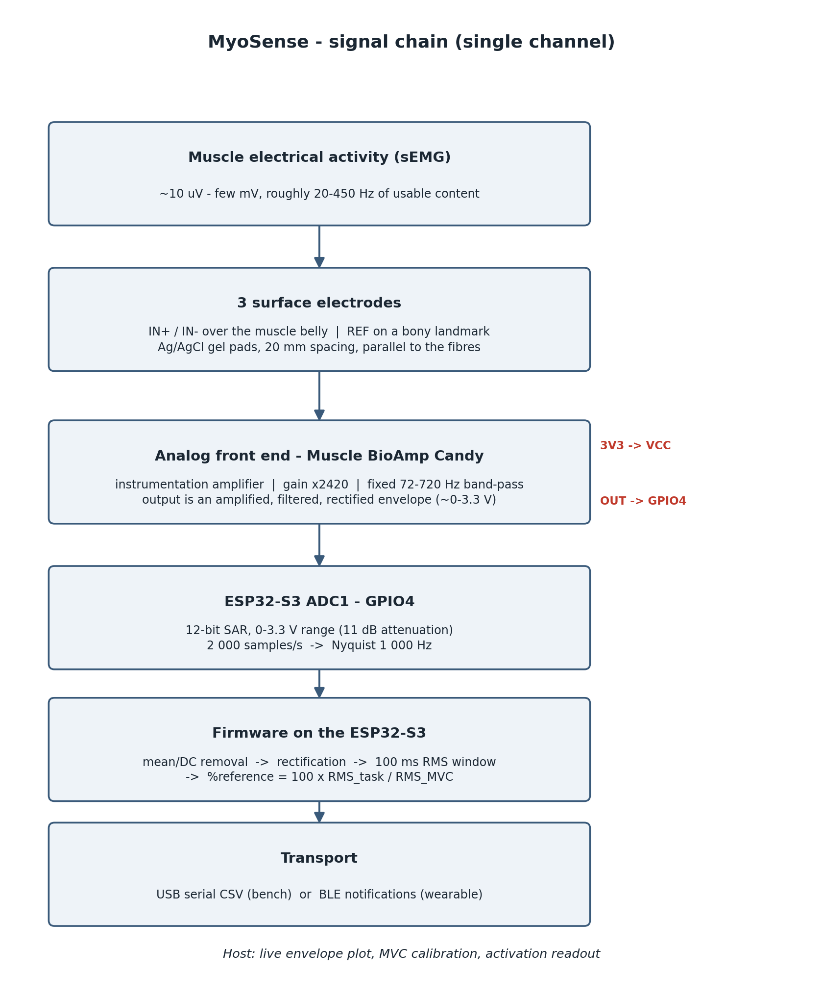
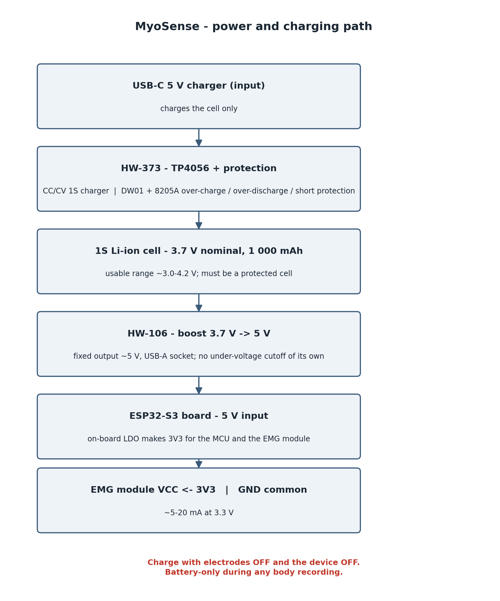

# MyoSense — Surface EMG Wearable for Muscle-Activation Feedback
## A complete project guide: physiology, hardware, firmware, calibration, testing and extension

**DH803 — Wearable Health Technologies**
**Jeet Gurbani (23B0023), IIT Bombay**
**Guide revision: 18 November 2026**

---

## How to read this document

This is the single reference for the project. It assumes you know nothing about EMG and ends with a re-buildable specification. Every design decision is stated together with the alternative that was rejected and why.

Sections 1–6 build the intuition. Sections 7–10 are the engineering: components, circuit, firmware, signal processing. Sections 11–14 are the operating manual: calibration, test day, reading results. Sections 15–16 cover the two-channel version and the demonstration currently being run. Sections 17–21 are validation, limits, safety, troubleshooting and the bill of materials.

If you only have ten minutes, read Sections 1, 3, 9 and 11.

---

## 1. What the project is

A wearable that records the electrical activity of a muscle, converts it into a single amplitude number, and expresses that number relative to the same muscle's own maximum voluntary contraction (MVC). The result is a percentage that a lifter can watch while training.

The system measures **surface electromyography (sEMG)** — the small voltage that appears on the skin when muscle fibres are electrically active. It does not measure force, and it cannot judge technique. This distinction is the intellectual core of the project and is defended in Section 5.

### 1.1 What exists and works today

| Element | State |
|---|---|
| Analog front end | Muscle BioAmp Candy, one channel, powered from 3V3 |
| Controller | ESP32-S3 N16R8 development board, dual USB-C |
| Acquisition | 2 000 samples/s on GPIO4 (ADC1), 12-bit |
| Processing on-device | DC/mean removal → rectification → 100 ms RMS window |
| Calibration | 5-second MVC capture, triggered by `C` on the serial line |
| Output | `Mean`, `RMS` and `Activation %` at 10 Hz over USB serial |
| Power | 1S Li-ion cell → TP4056 charger/protection → HW-106 boost → 5 V → board |
| Host tools | Live envelope plot and CSV logger (`tools/emg_plot.py`), capture/summary (`tools/emg_capture.py`) |
| Second channel | Not built. Wiring and firmware plan in Section 15 |
| Current demonstration | Sequential single-site measurement (Section 16) |

### 1.2 The two claims this project makes, and the three it refuses to make

**Made:**
1. The device records a repeatable, unclipped surface-EMG amplitude envelope from a selected muscle, with a documented sample rate and analog passband.
2. It expresses that amplitude relative to a reference contraction of the same muscle, producing a within-person percentage that can be tracked across trials.

**Refused:**
1. It does not measure muscle force, and it does not measure each muscle's share of joint torque.
2. It does not certify that a repetition is performed correctly.
3. It does not predict or guarantee hypertrophy.

Each refusal is a consequence of the physics in Section 5, not of a limitation we chose to accept.

---

## 2. From a motor neuron to a millivolt on the skin

### 2.1 The five steps that create the signal

1. A motor neuron in the spinal cord fires an action potential.
2. It travels down the axon to the **neuromuscular junction** and releases acetylcholine.
3. The muscle fibre membrane depolarises — an action potential spreads along the fibre.
4. Calcium is released inside the fibre, enabling actin and myosin to generate tension.
5. The fibre's depolarisation, summed across thousands of fibres, produces a changing electric field that reaches the skin.

Steps 1–3 are electrical; step 4 is mechanical. Surface EMG captures steps 1–4 and is blind to the mechanical result. That is the entire reason EMG cannot be read as force.

### 2.2 Motor units and the interference pattern

A **motor unit** is one motor neuron plus all the muscle fibres it innervates — typically hundreds. Its electrical signature at the skin is a **motor-unit action potential (MUAP)** lasting a few milliseconds.

Two control mechanisms raise force:

- **Recruitment** — more motor units switch on. The Henneman size principle means small, slow units are recruited first and large, fast units last.
- **Rate coding** — already-active units fire more often.

Because a surface electrode sees many units at once, the trace is not a series of clean pulses. It is an **interference pattern**: the algebraic sum of many MUAPs, each arriving at a different time and distance, partially cancelling each other.

This summation explains a fact that surprises most people: **EMG amplitude is not proportional to the number of active fibres.** Positive and negative contributions cancel, so doubling the number of active units does not double the recorded amplitude. Amplitude rises monotonically with effort, but non-linearly and with saturation.

### 2.3 Volume conduction

Between the fibre and the electrode lie muscle tissue, fascia, fat and skin. These act as a **volume conductor**: they spatially smear the source and act as a low-pass filter. Consequences:

- Deep muscles produce weaker, blurrier surface signals than superficial ones.
- Fat thickness changes amplitude between people, and between sites on one person.
- The same muscle recorded at two skin locations can give different amplitudes for identical activation.

This is the reason a raw amplitude in millivolts is not comparable across people, sessions or electrode placements — and the reason everything in this project is normalised to a within-session reference.

### 2.4 What fatigue does

During a sustained submaximal contraction, the nervous system recruits additional units to hold the load, so **RMS amplitude tends to rise**. Simultaneously, conduction velocity along the fibres falls, which shifts the power spectrum toward lower frequencies, so the **median frequency tends to fall**.

Both effects require stable geometry. In dynamic repetitions the muscle slides under the electrode, so the spectrum changes for mechanical reasons as well as physiological ones. This project therefore treats frequency-based fatigue as out of scope on this hardware (Section 12.6).

---

## 3. Signal characteristics that drive the design

| Property | Value | Design consequence |
|---|---|---|
| Amplitude at the skin | ~10 µV to a few mV | Needs gain of a few thousand before an ADC sees it |
| Usable bandwidth | roughly 20–450 Hz (conventional) | Sampling must exceed 900 Hz; this front end passes 72–720 Hz, so sampling is set at 2 kHz |
| Source impedance | kΩ–MΩ, unstable with dry skin | Amplifier input impedance must be far higher |
| Dominant noise | 50 Hz mains + harmonics, motion artifact, ECG on the trunk | Differential recording, high CMRR, short leads, skin prep |
| Crosstalk | Neighbouring muscles leak in | Small inter-electrode spacing, careful placement |

Mains interference deserves emphasis because India runs at **50 Hz**. A 60 Hz notch is a common imported-template error and does nothing here.

---

## 4. Why two muscles

Training advice frequently involves a target muscle and a helper. "Feel it in your chest, not your triceps." A lifter cannot verify that claim by sensation: in a study of sub-elite soccer players, perceived and measured activation corresponded poorly across a set of upper-body exercises [8].

Two recording sites let you ask, within one person and one protocol, whether a cue changes the pattern. Candidate pairs and their literature:

| Exercise | Target / comparison sites | What the literature actually shows |
|---|---|---|
| Lat pulldown | Latissimus dorsi / biceps brachii | The lat:biceps ratio changes with exercise variant and varies substantially between people [9] |
| Bench / chest press | Pectoralis major / triceps brachii | Both are active; the balance depends on load, phase, stability and cue [7, 10] |
| Lateral raise | Middle deltoid / upper trapezius | Variants shift the pattern in a small bodybuilder sample [11] |

None of these studies license a statement like "your biceps is taking over". They license measuring both sites under a fixed protocol and reporting both numbers.

---

## 5. What sEMG can and cannot tell you

| sEMG can estimate | sEMG alone cannot establish |
|---|---|
| Electrical activity of the underlying muscle over time, under a stated setup | Absolute force, or a muscle's share of joint torque |
| Relative change within one muscle when placement, processing and reference are fixed | That a repetition is biomechanically correct |
| Onset timing and co-occurring patterns across selected sites | Long-term hypertrophy, or that higher acute EMG yields more growth |

Amplitude normalisation improves interpretability but does **not** remove crosstalk, fat-layer differences or electrode-placement effects [1, 2].

---

## 6. Design principles adopted

1. **One variable at a time.** Task and reference are recorded with identical electrodes, gain, filtering and window length. Change one thing and the comparison dies.
2. **Normalise within the person.** Absolute millivolts carry no meaning across people.
3. **Never invent a scale.** Call something %MVC only when the denominator really is a maximal voluntary contraction under a documented posture.
4. **Measure the artefact before filtering it.** Inspect the spectrum before applying a notch.
5. **State the band you actually have.** The front end passes 72–720 Hz; no downstream processing recovers what it removed.
6. **Battery power on the body.** A person connected to electrodes must not also be connected to mains-referenced equipment.

---

## 7. System architecture

{width=95%}

The chain in words:

1. Three electrodes pick up the potential difference across the muscle.
2. The BioAmp Candy amplifies, filters and rectifies it, producing an analog output in the 0–3.3 V range.
3. The ESP32-S3 digitises that output at 2 000 samples/s on GPIO4.
4. Firmware removes the slowly varying baseline, computes a 100 ms RMS, and divides by the stored MVC value.
5. The result leaves over USB serial (bench) or BLE (wearable).

---

## 8. Component choices, and what was rejected

### 8.1 EMG front end — Muscle BioAmp Candy

Vendor-stated characteristics: input supply 3.3–30 V, fixed gain ×2420, fixed analog band-pass of **72–720 Hz**, single channel, three-electrode interface (`IN+`, `IN−`, `REF`), assembled SMD module [16].

**Why chosen:** it runs directly from 3.3 V, it is assembled, it needs no bipolar supply, and its output already suits a microcontroller ADC. For an amplitude-envelope prototype that is exactly the required feature set.

**What it costs you:** the 72 Hz high-pass sits well above the conventional 20 Hz lower corner. The passband is narrower and shifted compared with research-grade systems, so spectral comparisons with published 20–450 Hz data are invalid, and median-frequency fatigue analysis is not defensible. This is accepted deliberately: the project measures amplitude, not spectrum.

### 8.2 Alternatives considered

| Option | Why not chosen here |
|---|---|
| **Muscle BioAmp BisCute** | Same electrical specification but a through-hole DIY kit. Cheaper, but adds assembly and inspection work with no functional gain [17] |
| **BioAmp EXG Pill, 2025 edition** | Configurable gain and band-pass, better for future spectral work, but roughly 3× the cost and defaults to EEG/EOG, needing reconfiguration [18] |
| **MyoWare 2.0** | Excellent snap ecosystem and raw/rectified/envelope outputs, but ~₹4 600 per channel in India |
| **DFRobot Gravity SEN0240** | Convenient dry electrode and integrated conditioning, ~₹5 000 per channel |
| **AD8232 breakout** | Cheap and common, but ECG-oriented with fixed 0.5–40 Hz-ish response; needs redesign for EMG |
| **Muscle Sensor v3 clone** | Requires ±3.5 V dual rails and its output can reach the positive rail; more power complexity, more risk |

### 8.3 Controller — ESP32-S3 N16R8 development board

Requirements that drove the choice: an ADC with at least 11 effective bits over a 3.3 V span, a sample loop that sustains 2 kS/s without jitter, and a wireless link for the wearable case.

The ESP32-S3 provides a 12-bit SAR ADC, hardware timers, BLE 5 and dual USB-C. GPIO4 and GPIO5 are ADC1 channels, which matters: **ADC2 shares hardware with the Wi-Fi radio** and becomes unreliable when wireless is active. All analog work stays on ADC1.

An earlier plan specified a DFRobot FireBeetle 2, which has an integrated Li-ion charger and PH2.0 battery socket. The board in hand is a generic ESP32-S3 devkit without that charger, which is why the external charger and boost exist in the power chain.

### 8.4 Electrodes

Three contacts per channel: `IN+` and `IN−` over the muscle belly, `REF` on a bony, electrically quiet landmark (olecranon, clavicle, anterior superior iliac spine).

- **Ag/AgCl hydrogel pads** are the reference-quality choice: low and stable skin impedance, best signal-to-noise, single-use.
- **Dry metal band contacts** are reusable but need conductive gel at the metal–skin interface and have higher, drifting impedance.
- **Spacing:** ~20 mm centre-to-centre, parallel to the fibre direction, between the innervation zone and the tendon. These are SENIAM-style general recommendations; muscle-specific guidance takes precedence [4].

### 8.5 Power chain

{width=95%}

| Stage | Part | Role | Verified characteristic |
|---|---|---|---|
| Cell | 1S Li-ion, 3.7 V nominal, 1 000 mAh | Energy | Usable range ~3.0–4.2 V |
| Charger/protection | HW-373 (TP4056 + DW01/8205A) | CC/CV charging, over-charge/over-discharge/short protection | Linear charger; output is battery voltage |
| Boost | HW-106 (3.7 V → 5 V) | Creates the 5 V rail the devkit expects | Fixed ~5 V, USB-A socket output |
| Board regulator | On-board LDO | 5 V → 3.3 V for MCU and sensor | — |

**The critical misconception this design avoids:** a TP4056 board is a charger, not a power supply. Its `OUT+`/`OUT−` sit at battery voltage, 3.0–4.2 V. Feeding that into a devkit's `5V` pin leaves the LDO below dropout and the board browns out. The boost exists solely to fix that.

**Why not an LDO instead?** A 3.3 V LDO from the cell into the `3V3` pin works and is quieter, but it cannot regulate once the cell falls below ~3.45 V, wasting roughly a quarter of the capacity. The boost uses the whole cell.

**Why not power the board from USB and skip all this?** Bench work, yes. On a person, no — see Section 19.

---

## 9. Circuit details

### 9.1 Pin map, as built

| From | To | Note |
|---|---|---|
| EMG `VCC` | ESP32 `3V3` | Sensor draws ~5–20 mA |
| EMG `GND` | ESP32 `GND` | Common reference is mandatory |
| EMG `OUT` | ESP32 `GPIO4` (ADC1_CH3) | 0–3.3 V analog |
| EMG `IN+` | Electrode over muscle belly | Silver side to skin |
| EMG `IN−` | Second electrode, ~20 mm along the fibres | Same muscle |
| EMG `REF` | Electrode on a bony landmark | Not over muscle |

For a second channel: `OUT` → `GPIO5` (ADC1_CH4), with its own three electrodes and its own reference.

### 9.2 Wiring diagram

```text
                      +----------------------------+
   electrodes         |   Muscle BioAmp Candy      |
  IN+ o----+          |                            |
  IN- o----+--------->| IN+  IN-  REF              |
  REF o----------------|>REF                        |
                      |                            |
                      | VCC   GND   OUT            |
                      +--+-----+-----+-------------+
                         |     |     |
                     3V3 |     | GND | GPIO4 (ADC1)
                         |     |     |
                      +--+-----+-----+-------------+
                      |      ESP32-S3 N16R8        |
                      |                            |
                      |  5V  GND   3V3             |
                      +--+----+-----+--------------+
                         |    |     |
              USB-C 5V <-+    |     +--> (EMG VCC, above)
                         GND
```

### 9.3 Power wiring

```text
 USB-C 5V --> [HW-373] --B+/B---> [1000 mAh cell]
                |
                +--OUT+/OUT-----> [HW-106] --USB-A--> USB-A-to-C --> ESP32 USB-C
```

### 9.4 Electrical rules that are not optional

1. **Never exceed 3.3 V at an ADC pin.** The ESP32-S3 is not 5 V tolerant on analog inputs.
2. **Never connect the cell or charger output to the `5V` pin.** Only a regulated ~5 V source goes there.
3. **Never have the boost and a USB host connected simultaneously** to the same board in a way that back-feeds — pick one source.
4. **Never charge while electrodes are on a person.**
5. **Meter before connecting** at three points: cell polarity, boost output, board 3V3 rail.

### 9.5 Why GPIO4 and GPIO5

Both are ADC1 channels. ADC1 stays available when Wi-Fi or BLE is active; ADC2 does not. GPIO4 is `ADC1_CH3`, GPIO5 is `ADC1_CH4`. Using two adjacent ADC1 pins keeps both channels on the same converter and the same attenuation setting, which matters for a fair comparison.

---

## 10. Firmware

### 10.1 Reference sketch

`firmware/team_mvc/team_mvc.ino` is the working build, preserved from the 18 November sketch. Data is logged to CSV on the host by `tools/emg_capture.py`, which parses the sketch's text output.

### 10.2 Structure

| Stage | Implementation | Reason |
|---|---|---|
| Sampling | `micros()` target clock, 500 µs period, catch-up correction | Stable 2 kHz without a hardware timer |
| Conversion | `analogReadMilliVolts()` | Uses the chip's calibration, returns millivolts |
| Baseline | Window mean subtraction | Removes electrode offset and drift |
| Amplitude | RMS of the window | Standard sEMG amplitude estimator |
| Normalisation | `activation = 100 × RMS / MVC` | The %reference metric |
| Output | Text line at 10 Hz | Human-readable; 100 ms window = 10 updates/s |

### 10.3 Sampling rate choice

The front end passes up to 720 Hz. Nyquist requires >1 440 Hz. 2 000 samples/s gives a 1 000 Hz Nyquist margin, leaves headroom for the analog roll-off, and divides evenly into the timing loop.

### 10.4 Window length choice

A 100 ms RMS window contains 200 samples. Shorter windows (20–40 ms) track fast changes but are noisier; longer windows are stable but smear onset. At 100 ms the output updates 10 times per second, which is adequate for watching a contraction build and release.

### 10.5 Serial protocol

```
Mean: 1.62 mV | RMS: 0.481 mV | Activation: 12.4%
```

```
MVC CALIBRATION STARTED
Contract your target muscle.
MVC CALIBRATION COMPLETED
MVC RMS: 3.884 mV
```

Command: `C` starts a 5-second MVC capture. The peak RMS in that window becomes the denominator.

### 10.6 A subtlety worth understanding

The Candy output is already rectified and smoothed by the module. Several amplitude measures are therefore available:

- **Mean of the envelope above resting baseline** — rises with activation, is the most natural read of a smoothed envelope.
- **RMS of the AC fluctuation** — what the current firmware computes; also rises with activation, and rejects any DC offset automatically.

Both respond monotonically. Pick one, use it for both task and MVC, and never mix them. A quick check: during a contraction both numbers should climb; at rest both should sit near their baseline. If the mean is flat while RMS moves, the output is envelope-like and the mean-above-baseline metric is the better choice.

### 10.7 Known firmware improvements

| Item | Current behaviour | Better behaviour |
|---|---|---|
| MVC estimate | Peak RMS sample in 5 s | Mean of the top 5–10 % of samples, or mean of 3 consistent contractions |
| Activation ceiling | Clamped to 100 % | Leave uncapped; >100 % signals a weak reference or moved electrodes |
| Drift | Window mean handles it | Add explicit re-zero command |
| Channels | One | Two, with per-channel normalisation |

---

## 11. Calibration: what MVC means and how to do it

### 11.1 The definition

`%MVC = 100 × A_task / A_MVC`, where `A` is the chosen amplitude measure and both are recorded from the **same electrode pair, same gain, same filtering, same window**.

Calling it %MVC is only honest if the denominator is a genuine maximal voluntary contraction performed under a documented posture and instruction.

### 11.2 Why normalisation is essential

Absolute millivolts depend on fat thickness, skin impedance, electrode placement, gain and temperature. None of that is comparable across sessions, sites or people. Dividing by a same-session reference removes most of the scaling variation and leaves a number that can be tracked.

It does not remove crosstalk, and it does not make two muscles' percentages comparable in force terms [1].

### 11.3 Protocol

1. **Prepare skin.** Shave if necessary, clean with alcohol, let it dry. Place electrodes and mark the positions.
2. **Familiarise.** Two or three submaximal contractions so the participant knows the task.
3. **Fix the posture.** Write down joint angle, body position, and how resistance is applied. Photograph it.
4. **Instruct.** "Push as hard as you can against this, without moving."
5. **Capture.** Trigger `C`, hold maximal effort for the full 5 s.
6. **Rest 1–2 minutes.**
7. **Repeat** for 3–5 trials. Take the mean of the best three, or use the median.
8. **Record** all trial values, not just the final one — the spread is your calibration uncertainty.

### 11.4 Reading above 100 %

A task value above 100 % is possible and is **not** an error to clamp. It means one of:

- the MVC was not truly maximal,
- the posture during MVC differed from the task posture,
- the electrodes moved between calibration and task,
- the task involved a contraction type (e.g. dynamic) that produces higher amplitude than the isometric reference.

Investigate; do not hide it.

### 11.5 What calibration does not solve

An isometric MVC is not a dynamic repetition. Muscle length, contraction velocity and joint angle differ, and EMG is sensitive to all three. State this every time you report a percentage derived from a mismatched reference.

### 11.6 Re-calibrating

Re-calibrate whenever electrodes are re-placed, the sensor is power-cycled with a different supply, or the session moves to a new muscle. A 5-second calibration is cheap; a corrupted normalisation ruins a whole dataset.

---

## 12. Operating procedure

### 12.1 Bench test (no person)

1. Wire `VCC → 3V3`, `GND → GND`, `OUT → GPIO4`. Leave electrodes unconnected.
2. Power from USB. Electrodes must not touch anyone.
3. Upload `team_mvc.ino`. Open Serial Monitor at 115 200 baud.
4. Expect the banner, then lines at 10 Hz. With floating inputs, RMS is small and stable; `Mean` sits somewhere mid-scale.
5. Confirm nothing is clipped: if `Mean` sits at 0 or at the supply rail, stop and check the module.
6. Optionally capture and plot: `python tools/emg_capture.py --seconds 10`.

### 12.2 Preparing a participant

1. Explain the procedure; obtain consent; confirm course/instructor approval.
2. Inspect skin — no cuts, no irritation, no dermatitis.
3. Clean and dry the sites.
4. Apply electrodes: `IN+` and `IN−` along the muscle belly, `REF` on bone.
5. Route leads with strain relief: tape the cable to the skin 5 cm from the electrodes.
6. Confirm the device is on battery power and **no USB cable to a computer is attached**.

### 12.3 Recording a trial

1. Power on, wait for the banner.
2. Subject relaxes; note the resting RMS as the baseline.
3. Press `C`; subject performs the MVC for 5 s.
4. Rest 1–2 min; repeat until 3–5 references are captured.
5. Run the task condition.
6. Log: muscle, site, electrode type, spacing, reference location, posture, load, tempo, cue, and every number.

### 12.4 What to do between sites

When moving the sensor, treat it as a complete restart: new skin prep, new placement, new baseline, new MVC. Nothing carries over.

---

## 13. Reading the data

### 13.1 A valid recording

- Resting RMS low and steady, with occasional small spikes from movement.
- Contraction produces a clear rise within ~100–300 ms.
- Release returns to baseline within a few hundred milliseconds.
- No sample sits pinned at 0 or the rail.
- Repeated contractions give similar peak amplitudes, within roughly ±15 % for a cooperative subject.

### 13.2 Artefact signatures

| Signature | Likely cause | Fix |
|---|---|---|
| 50 Hz ripple visible in the raw trace | Mains pickup, long unshielded leads | Shorten leads, twist them, move away from mains equipment, consider a notch |
| Slow large swings unrelated to contraction | Motion artefact / cable tug | Strain-relieve the cable, secure electrodes, high-pass the baseline more aggressively |
| Periodic sharp spikes at ~1 Hz | ECG (on trunk/shoulder sites) | Move the site, or template subtraction |
| Amplitude jumps when the subject shifts | Electrode lift or skin impedance change | Re-prep and re-place |
| Signal dies mid-trial | Battery sag or boost dropout | Recharge; check boost output under load |
| Envelope never changes | `OUT` not on GPIO4, or module unpowered | Verify wiring and supply |

### 13.3 Ratios

Two channels give two percentages. A ratio (comparison ÷ target) is a **descriptive within-person index**. Report both channel values beside it, and never label it compensation, co-activation or relative force [1].

---

## 14. Validation

### 14.1 Signal quality metrics to report

- Baseline envelope and its standard deviation.
- Peak envelope during MVC.
- Signal-to-baseline ratio.
- Percentage of clipped samples.
- Achieved sample rate and dropped-sample count.

### 14.2 Repeatability

Repeat the same condition with re-placed electrodes. Report the coefficient of variation across trials. Within-session repeatability will be far better than day-to-day, which is normal for sEMG.

### 14.3 Agreement, not correlation

If a research-grade system is available, compare same-site, same-task recordings with **Bland–Altman** (bias and limits of agreement) rather than Pearson *r*. High correlation with a large bias means the device is consistently wrong in the same direction — which is exactly what a single-number validation would hide [7].

### 14.4 What a student pilot can and cannot claim

A small convenience sample can demonstrate feasibility, repeatability and a plausible cue effect. It cannot establish population-level effectiveness, and it cannot validate the device against clinical standards.

---

## 15. The two-channel version

### 15.1 What changes

| Item | One channel | Two channels |
|---|---|---|
| Front ends | One Candy | Two Candy modules |
| Electrodes | 3 | 6 |
| ADC pins | GPIO4 | GPIO4 + GPIO5 |
| Firmware | One RMS accumulator | Two accumulators, two baselines, two MVC values |
| Output | One percentage | Two percentages plus an optional ratio |
| Power | ~10 mA | ~20–40 mA (still trivial for the cell) |

### 15.2 Wiring

```text
Channel 1:  VCC -> 3V3     GND -> GND     OUT -> GPIO4
Channel 2:  VCC -> 3V3     GND -> GND     OUT -> GPIO5
```

Both modules can share the 3V3 rail if the board's regulator has the headroom — check the datasheet current budget. Each module needs its **own** three electrodes and its own reference; never share a reference electrode between channels, because that couples the two recordings.

### 15.3 Firmware structure for two channels

Maintain per-channel state:

```c
struct Channel {
  uint8_t  pin;
  double   sum;
  double   sumSq;
  uint16_t count;
  float    rms_mV;
  float    mvc_mV;
  float    activation;
};
```

In the sampling loop, read both pins each tick, accumulate into both structures, and emit one line per window with both channels. Calibrate them independently — `C1` and `C2` commands, or calibrate sequentially.

### 15.4 Synchronisation

Sampling both pins in the same loop iteration gives channel-to-channel skew of a few microseconds, which is negligible compared with the 100 ms window. Do **not** alternate whole windows between channels; that destroys simultaneity.

### 15.5 The interpretation trap

Two normalised percentages from two different muscles are **not** a force comparison. Each is relative to its own maximum. A 60 % / 30 % reading does not mean the first muscle is doing twice the work. What it supports is a within-person, within-protocol statement: "under this cue, this ratio shifted in this direction."

### 15.6 Crosstalk

When two sites are close (deltoid/trapezius, for example), a single module can pick up both muscles. This is a hardware and placement problem, not a software one. Check by contracting one muscle in isolation and watching the other channel's envelope.

---

## 16. The current one-channel demonstration

One sensor cannot record two sites simultaneously. The demonstration therefore measures **sequentially** and is explicit about it.

### 16.1 Two valid versions

**Version A — placement sensitivity (same muscle).**

Keep the muscle, posture and contraction identical. Move the electrode pair between two marked positions on that muscle. Show how the recorded amplitude changes with placement alone.

*Message:* electrode placement is a first-order determinant of amplitude; that is why placement is documented and marked.

**Version B — site comparison (different muscles).**

Choose two accessible sites, define a safe isometric task for each, and calibrate each separately. Report each site's own percentage.

*Message:* the same instrument and the same normalisation procedure work at different sites, and each site's reference makes its own percentage meaningful.

### 16.2 Protocol

1. Site 1: prep, place, rest baseline, `C` ×3.
2. Task at site 1: three submaximal holds, recorded.
3. Remove electrodes. Re-prep site 2. Place, baseline, `C` ×3.
4. Task at site 2: same structure.
5. Report: per-site baseline, per-site MVC, per-site task percentage.

### 16.3 What the numbers will show

Each site's MVC normalises to ~100 % **by construction**. So do not present "muscle A reached 100 %, muscle B reached 100 %" as a result. What is informative is:

- task percentage relative to that site's own reference,
- the repeatability of the reference within a site,
- the difference in raw millivolts between sites, presented as an instrumentation observation and explicitly **not** as a strength or force finding.

### 16.4 Suggested narration for a review

> "One channel is available, so we measure sites sequentially rather than simultaneously. For each site we place electrodes, record a resting baseline, calibrate an MVC reference, then record a submaximal task. The output is a percentage of that site's own reference. Because each site is normalised to its own maximum, these percentages are not comparable as force; they demonstrate that the instrument and the calibration procedure generalise across sites. Simultaneous two-muscle comparison is the next build step."

---

## 17. Limitations, stated plainly

1. **Bandwidth.** 72–720 Hz. Not comparable with 20–450 Hz literature; no defensible spectral fatigue analysis.
2. **One channel today.** No simultaneous comparison, no ratio from this build.
3. **Amplitude, not force.** Non-linear, saturating, anatomy-dependent.
4. **Isometric reference vs dynamic task.** A known mismatch, always reported.
5. **Placement sensitivity.** Small displacements change amplitude materially.
6. **No galvanic isolation.** The device is safe only because it is battery powered during body contact.
7. **Uncalibrated absolute scale.** Millivolts are the ADC's estimate, not a metrology-grade measurement.
8. **Single-subject demonstrations.** Feasibility evidence, not population evidence.

---

## 18. Safety and ethics

**Electrical.** Surface EMG is passive. The device must never stimulate. During any body contact, the entire acquisition chain is battery powered, with no charger and no cable to a mains-connected computer. Prefer BLE to a battery-powered phone.

**Skin.** Intact skin only. Stop at the first sign of irritation. Single-use gel pads are not reused. Reusable bands are cleaned between users.

**Battery.** Protected cells only. Never charge a swollen or damaged cell. Never charge with electrodes attached. Verify polarity with a meter before first connection.

**Data.** EMG is health-adjacent data. Obtain informed consent, collect the minimum, store locally, and do not describe the prototype as a diagnostic or therapeutic device.

**Course.** Instructor approval and ethics clearance precede any human recording.

---

## 19. Troubleshooting

| Symptom | Likely cause | Action |
|---|---|---|
| No COM port appears | Charge-only cable; wrong USB-C socket; missing bridge driver | Use a data cable; try the other socket; the native USB socket needs no driver |
| Serial Monitor blank but port exists | `USB CDC On Boot` mismatch | Toggle the setting for that socket, re-upload |
| Upload fails to connect | Bootloader not entered | Hold BOOT, tap RESET, release, upload |
| Garbage characters | Baud mismatch | 115 200 |
| `Mean` pinned near 0 or 3.3 V | Output at a rail; module supply wrong | Check VCC/GND, verify module identity |
| Envelope never changes | `OUT` not on GPIO4; module unpowered | Continuity-check the wire, measure VCC |
| Huge baseline that wanders | Floating input or poor electrode contact | Re-prep skin, re-place, re-zero |
| Signal disappears when the boost is connected | Boost sagging or wiring reversed | Meter boost output under load |
| Values jump between trials | Electrode movement | Strain relief, mark placement, re-calibrate |

---

## 20. Bill of materials

| Item | Qty | Approx. cost | Notes |
|---|---|---|---|
| Muscle BioAmp Candy | 1 (2 for two-channel) | ₹800 each | [16] |
| ESP32-S3 N16R8 devkit | 1 | ₹700–1 200 | ADC1 on GPIO4/GPIO5 |
| 1S Li-ion 3.7 V 1 000 mAh | 1 | ₹250–400 | Protected cell |
| HW-373 TP4056 charger/protection | 1 | ₹40–80 | Verify DW01/8205A present |
| HW-106 boost 3.7 V→5 V | 1 | ₹50–90 | USB-A output |
| Ag/AgCl gel electrodes | 10–20 | ₹150–400 | Single use |
| USB-C data cable | 1 | — | Must carry data |
| USB-A-to-USB-C cable | 1 | — | Boost to board |
| Electrode band/strap | 1 | ₹100–300 | Or tape for the first tests |

---

## 21. Glossary

**ADC** — analog-to-digital converter.
**Ag/AgCl** — silver/silver-chloride electrode; low, stable skin impedance.
**Crosstalk** — signal from a neighbouring muscle appearing on the channel.
**Envelope** — smoothed magnitude of the rectified signal.
**MVC** — maximal voluntary contraction.
**MUAP** — motor-unit action potential.
**Nyquist frequency** — half the sample rate; the highest representable frequency.
**RMS** — root-mean-square; standard amplitude estimator for sEMG.
**sEMG** — surface electromyography.
**SENIAM** — European recommendations for sensor placement.
**CEDE** — consensus guidance for EMG study design and reporting.

---

## 22. References

1. Besomi M, et al. (2020). CEDE project: amplitude normalization matrix. *J Electromyogr Kinesiol* 53:102438.
2. Chowdhury RH, et al. (2013). Surface EMG signal processing and classification techniques. *Sensors* 13(9):12431–12466.
3. Muceli S, Merletti R (2024). Frequency analysis of the surface EMG signal: best practices. *J Electromyogr Kinesiol* 79:102937.
4. Hermens HJ, et al. (2000). SENIAM recommendations for SEMG sensors and sensor placement. *J Electromyogr Kinesiol* 10(5):361–374.
5. Sun J, et al. (2022). Application of surface EMG in exercise fatigue: a review. *Front Syst Neurosci* 16:893275.
6. Rodrigues SB, et al. (2022). EMG signal processing for the study of localized muscle fatigue. *IJERPH* 19(20):13270.
7. Calatayud J, et al. (2016). Importance of mind–muscle connection during progressive resistance training. *Eur J Appl Physiol* 116:527–533.
8. Sevilmis E, et al. (2024). The disconnect between perceived and actual EMG-measured muscle activation. *Percept Mot Skills*.
9. Lehman GJ, et al. (2004). Variations in muscle activation during latissimus dorsi weight-training exercises. *Dyn Med* 3:4.
10. Stastny P, et al. (2017). A systematic review of sEMG analyses of the bench press. *PLoS One* 12(2):e0171632.
11. Coratella G, et al. (2020). EMG analysis of lateral raise variations. *IJERPH* 17(17):6015.
12. Schoenfeld BJ, et al. (2018). Attentional focus strategies during long-term resistance training. *Eur J Sport Sci* 18(5):705–712.
13. Grgic J, et al. (2021). Attentional focus strategies and muscular strength: a meta-analysis. *Sports* 9(11):153.
14. DFRobot. FireBeetle 2 ESP32-S3 board documentation (earlier comparison option).
15. De Luca CJ, et al. (2010). Filtering the surface EMG signal. *J Biomech* 43(8):1573–1579.
16. Upside Down Labs. Muscle BioAmp Candy specifications and hookup guide.
17. Upside Down Labs. Muscle BioAmp BisCute build guide.
18. Upside Down Labs. BioAmp EXG Pill documentation.
19. DFRobot. Gravity analog EMG sensor SEN0240.
20. Thingbits. 3.7 V 1 000 mAh Li-ion-polymer battery listing.
21. Haugen ME, et al. (2023). Free-weight vs machine-based strength training: systematic review. *BMC Sports Sci Med Rehabil* 15:103.

Full DOIs, local file names and the bundled PDF set are listed in `SHARE_REFERENCES.md`.
